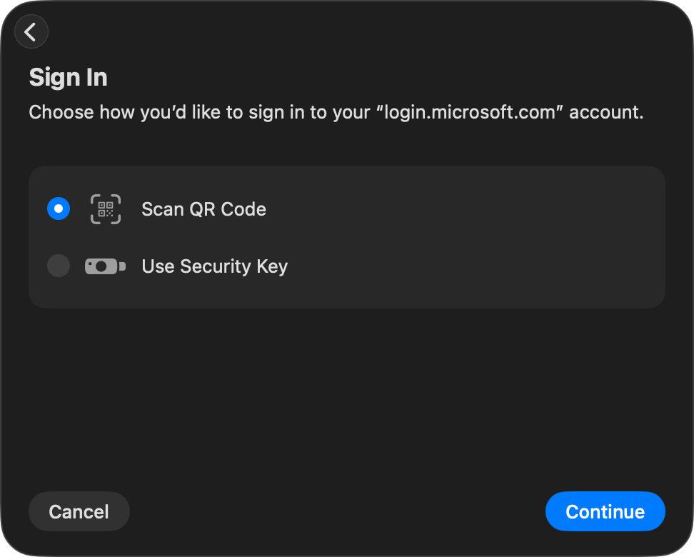
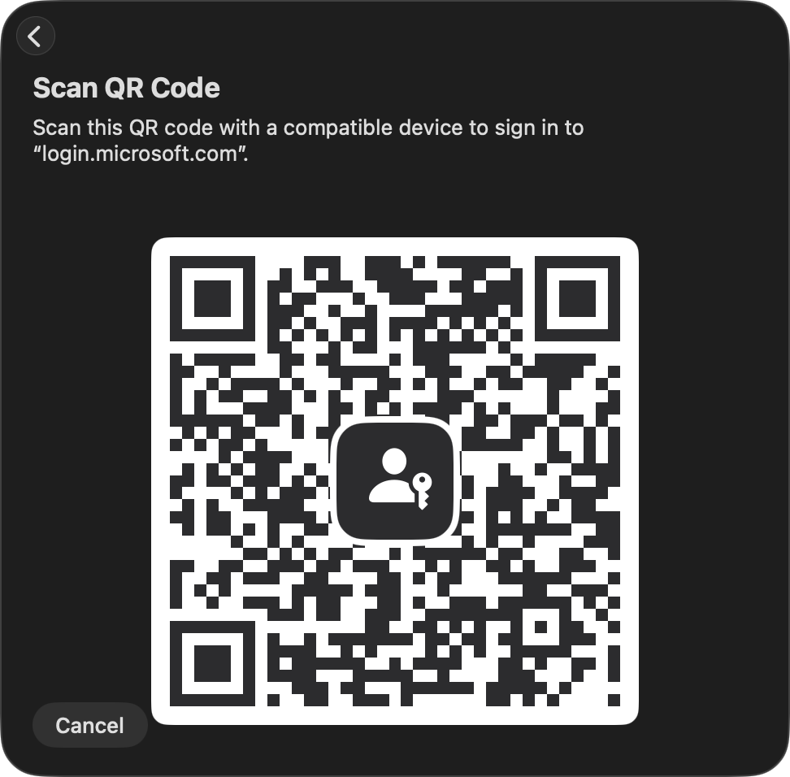
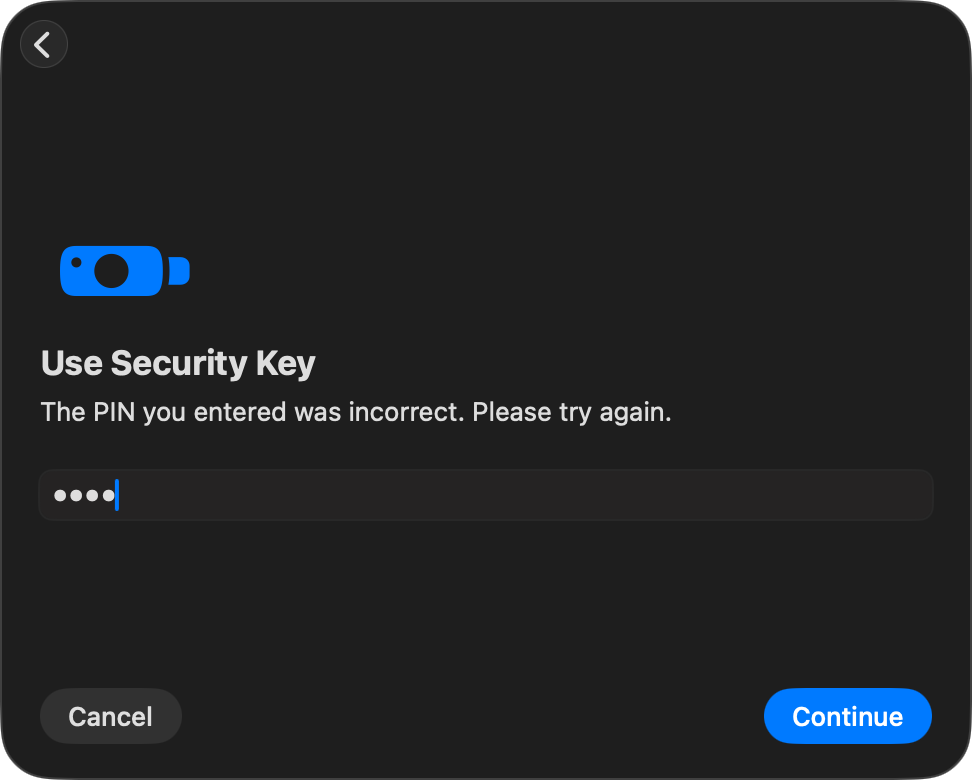

# phido2 for macOS

Command-line tool that gets a WebAuthn assertion from a FIDO2 USB security key
or from a phone that scans a QR code, **without**
the AuthenticationServices API and therefore without any entitlement. It shows
prompts that mimic the native macOS sign-in sheet; the icons and texts are
loaded at runtime from the system's AuthenticationServices framework.



## Build

Needs macOS 26.4, the Xcode Command Line Tools and Homebrew's libfido2.

The Command Line Tools provide the Swift compiler, `make` and `codesign`.
Homebrew's own installer normally sets them up; if they are missing:

```bash
xcode-select --install
```

Then install libfido2 (this also pulls in libcbor and OpenSSL):

```bash
brew install libfido2
```

Build from the repository root:

```bash
make
```

The result is `Build/bin/phido2-macos/release/phido2`: one ad-hoc signed
executable with libfido2, libcbor and libcrypto linked statically (it depends
only on system libraries).

| Command | Effect |
|---|---|
| `make` | Build and ad-hoc sign the executable. |
| `make test` | Run the unit tests. |
| `make clean` | Remove the build products. |
| `make distclean` | Also remove the prepared dependencies. |

## Layout

| Path | Contents |
|---|---|
| `Src/phido2-macos/Package.swift` | Swift Package Manager manifest. |
| `Src/phido2-macos/Makefile` | Prepares the static libraries, builds, signs, tests. |
| `Src/phido2-macos/*.swift` | Project source code. |
| `Src/phido2-macos/Info.plist` | Embedded into the executable; carries the Bluetooth usage description. |
| `Src/phido2-macos/CFido2/` | A header and module map that expose the libfido2 and libcbor C headers to Swift as the module `CFido2`. |
| `Src/phido2-macos/Tests/` | Unit tests. |

## Use

```bash
phido2 prompt --rpid login.microsoft.com --challenge AAECAwQFBgc --list --info
```

At least one of `--rpid`, `--list` and `--info` is required.

| Option | Meaning |
|---|---|
| `-r`, `--rpid` | Get an assertion for this relying party ID. |
| `-l`, `--list` | List all credentials on the key, of every relying party. |
| `-i`, `--info` | Print the authenticator's details. Alone, it needs no PIN and no touch. |
| `-c`, `--challenge` | Challenge, base64url or base64. Random if omitted. Needs `--rpid`. |
| `-p`, `--pin` | PIN. See "User verification" for what happens without it. |
| `-t`, `--transport` | `usb`, `hybrid`, or `any` (default). `any` shows a chooser. |
| `-s`, `--skip-user-verification` | Do not request user verification for the assertion; only a touch is needed. Needs `--rpid`. |
| `-d`, `--debug` | Debug-level messages and libfido2's CTAP/HID trace on stderr. |

Without `--rpid` nothing is signed and only a USB security key can be used.
To list every credential on a key, give `--list` (optionally with `--pin`);
this needs a key with credential management. To only identify the key:

```bash
phido2 prompt --info
```

### Hybrid transport



Choosing "Scan QR Code" (or `--transport hybrid`) shows a QR code. A phone
scans it, announces itself over Bluetooth, and the assertion travels through
the phone vendor's tunnel server.

None of that protocol is implemented here. The tool loads two private system
components into its own process:

- `ASCABLEClient` from AuthenticationServicesCore.framework: QR code,
  Bluetooth scan, tunnel and encrypted handshake.
- `_WKWebAuthenticationPanel` from WebKit: encodes the CTAP command.

Consequences:

- **Private API.** These classes have no public headers and can change in any
  macOS update. The tool checks for them and reports a clear error if they are
  gone. Verified on macOS 26.6.
- **Bluetooth permission.** macOS asks once to allow Bluetooth for
  "phido2". To make that possible for a single-file executable, the
  tool embeds an `Info.plist` and re-launches itself as
  its own "responsible process"; otherwise the permission would be attributed
  to the terminal, and Terminal cannot hold it.

### User verification

This section applies to USB security keys.

The first that applies is used:

1. `--pin`, if given and the key has a PIN.
2. The key's built-in verification (fingerprint), if enrolled. No PIN prompt is
   shown; the user touches the sensor. With `--list` this takes two touches:
   one to list the credentials, one for the assertion.
3. A PIN prompt, if the key has a PIN.
4. Touch only, if the key has neither.

If the fingerprint is blocked after too many mismatches, the PIN prompt is the
fallback.

A rejected PIN is asked for again:



With `--skip-user-verification` none of the above is used for the assertion:
the request carries no user verification, only a touch is needed, and the
signed flags have UV unset. Credentials the key protects with user
verification are then not offered, so the key may report that it has none.
Combined with `--list`, the listing still asks for the PIN or fingerprint,
because credential management cannot work without it. A phone is merely asked not to verify and may do so anyway.

## Monitor

```bash
phido2 monitor
```

Watches passkey ceremonies that another program, such as Safari, performs, and
exits as soon as one assertion or registration is done: status 0 if it
succeeded, 1 if it failed. With `--no-exit` it keeps monitoring one ceremony
after another until interrupted.

Two sources are watched at the same time: security keys on USB, and the
system log for sign-ins with a phone.

### Security keys (USB)

Every FIDO security key on USB is watched, including keys attached after the
tool has started.

- **How it listens.** The keys are opened through IOHIDManager,
  and macOS delivers a key's input reports to every program
  that has it open.
- **Only answers are visible.** What the other program sends to the key is not
  delivered to a second listener. The relying party therefore appears only as
  its SHA-256 hash, and each answer is recognised by its shape.
- **Exclusive access hides the traffic.** Nothing is seen while a program that
  opens the key exclusively uses it. This includes libfido2-based tools, and
  with them this tool's own `prompt` subcommand.

Deciding that a ceremony is over is partly inference:

| Observed | Reported as |
|---|---|
| Assertion with the user-present flag | Assertion succeeded. |
| Assertion without it | A browser's silent check for a credential; monitoring continues. |
| Registration answer | Registration succeeded. |
| Registration for the RP `.dummy` after "no credentials" | Assertion failed: browsers send this placeholder to wait for a touch before reporting that nothing matched. |
| U2F registration answer after a CTAP2 "no credentials" | Assertion failed: the same placeholder, sent after the browser fell back to U2F. |
| Error after the key waited for the user | Ceremony failed; the error does not say whether it was an assertion or a registration. |
| Error without such a wait | The answer to a silent check; monitoring continues. |
| U2F polling that stops for 3 seconds | Ceremony failed (cancelled or timed out). |

Verified with Safari on macOS 26.6. Browsers with their own USB code have not
been tried.

### Phones (hybrid transport)

A sign-in with a phone that scans a QR code never touches a USB device. The
system component that runs it writes its progress to the unified log, which
`monitor` follows through `/usr/bin/log stream`, limited to those messages.

- **Needs an administrator account.** macOS lets only members of the admin
  group read the log; no password prompt is involved. For anyone else this
  part is skipped, a log line says so, and security keys are still monitored.
- **Shown as they are.** From the QR code appearing (`Starting caBLE client`)
  to the end, each of the system's messages is logged unchanged, prefixed
  with `System log, <process>:`. This includes the phone being found
  (`Connecting to relay`) and the tunnel's errors.
- **End.** `Transaction succeeded.` ends the ceremony successfully,
  `caBLE transaction failed` unsuccessfully, for example when the prompt is
  cancelled. `monitor` then exits as it does for a security key. The log does
  not say whether it was an assertion or a registration, and no JSON is
  printed.
- **Redacted.** The system hides the relying party and the tunnel's address
  (`<private>`).

## Running a downloaded build

The binary is ad-hoc signed, not notarised. A copy downloaded with a browser
is quarantined, and Gatekeeper will refuse it until the attribute is removed:

```bash
xattr -d com.apple.quarantine phido2
```
