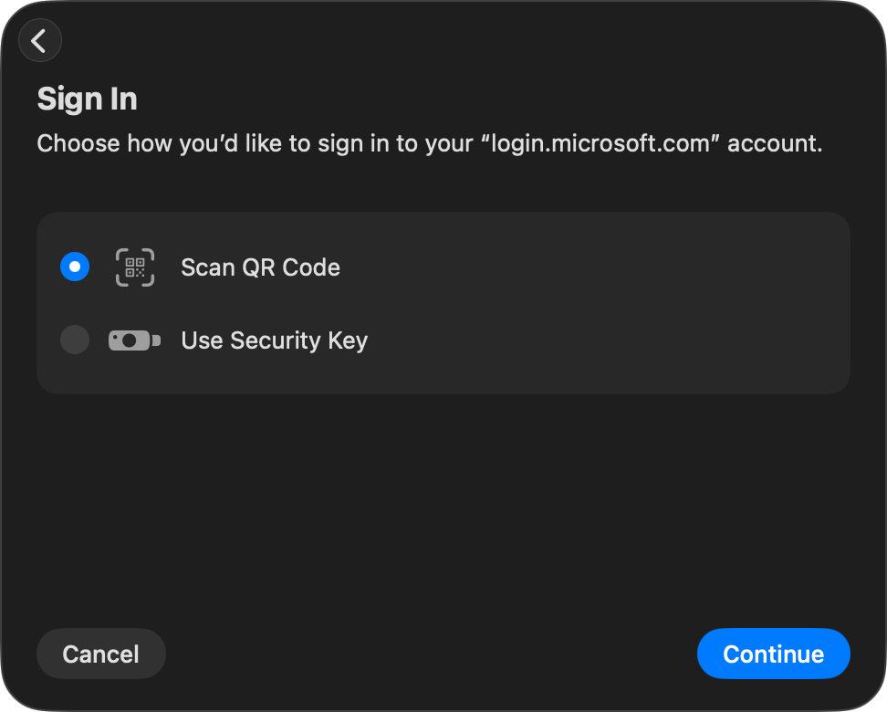
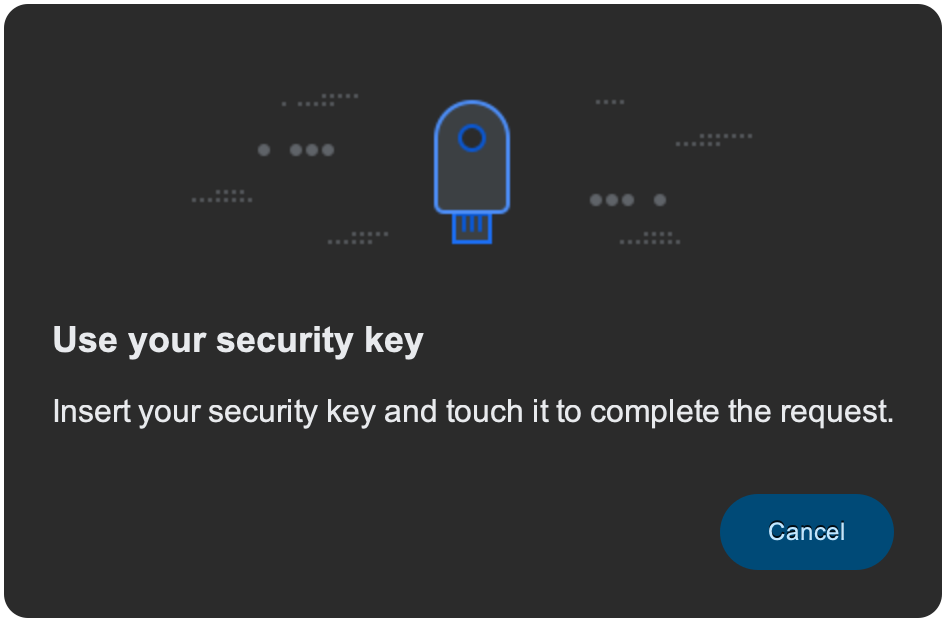
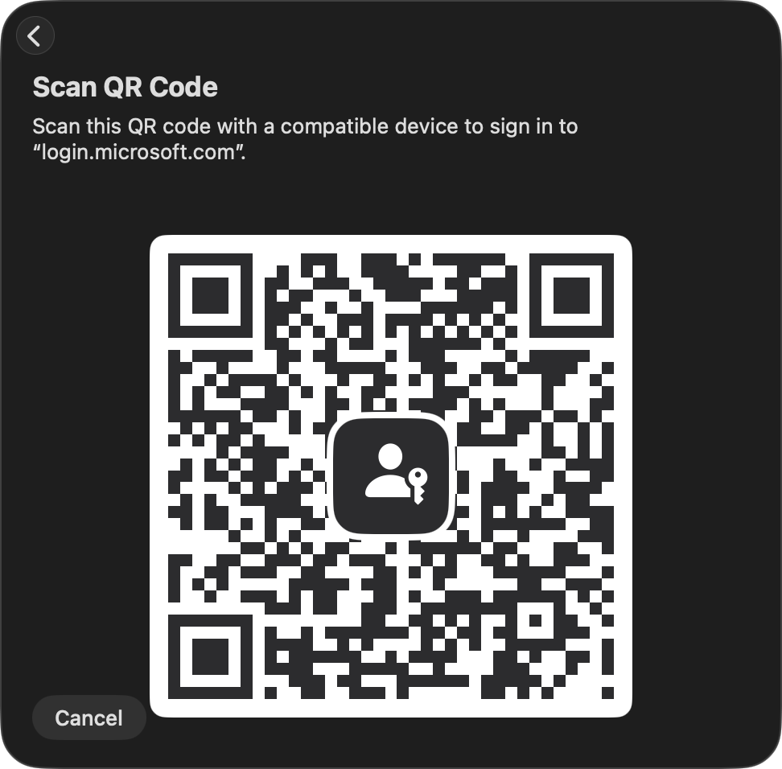
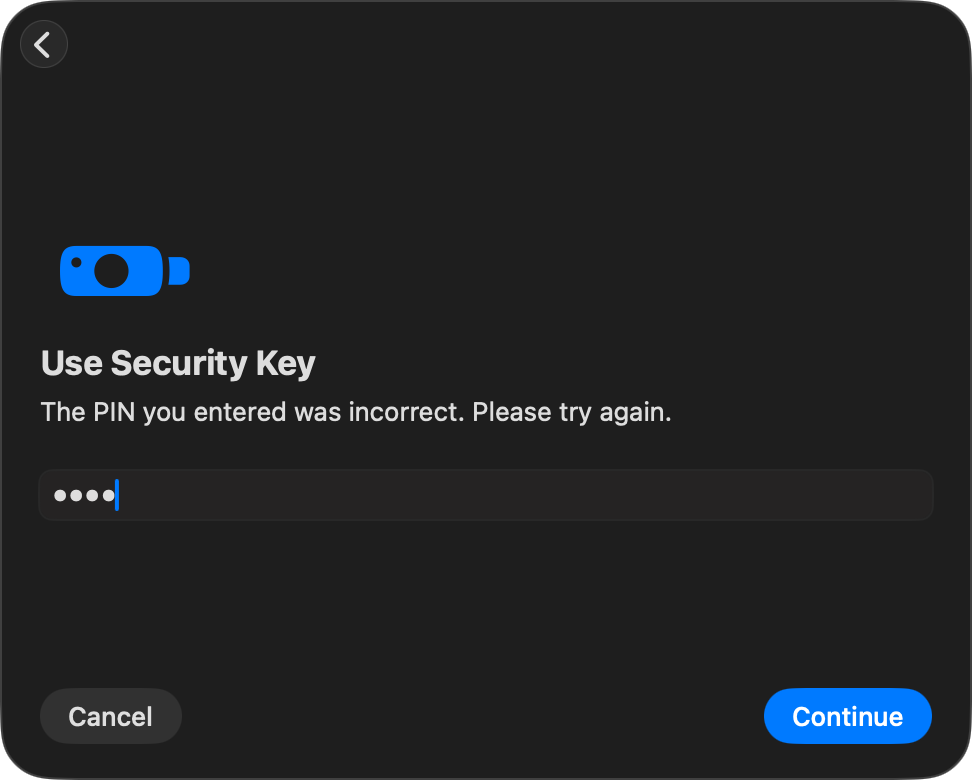
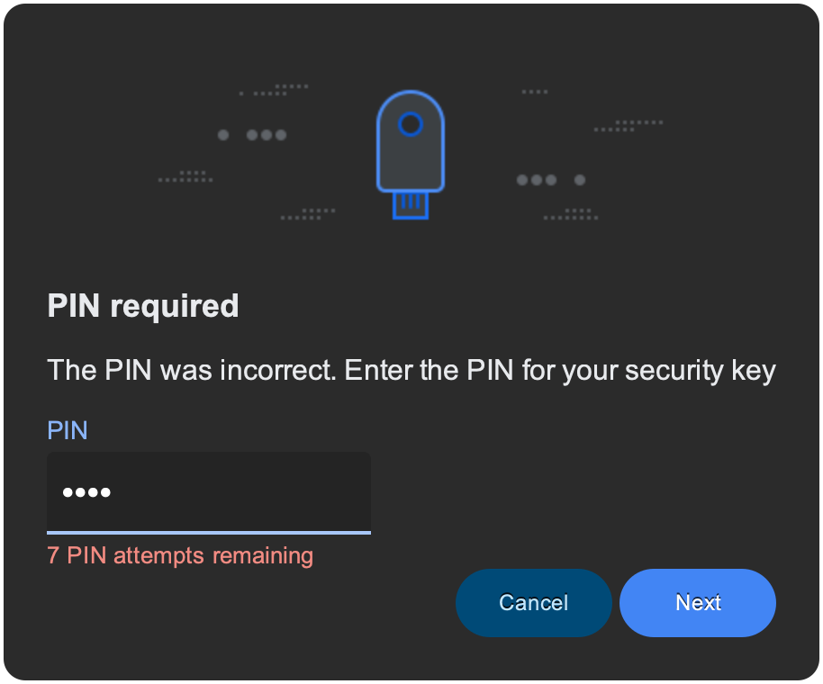

# phido2

Command-line tool for macOS and Linux that works with FIDO2 security keys
directly, without the operating system's or a browser's WebAuthn API:

- `phido2 prompt` gets a WebAuthn assertion from a USB security key (or, on
  macOS, from a phone that scans a QR code), lists the key's credentials and
  prints its details.
- `phido2 monitor` watches what a security key answers while another program,
  such as a browser, uses it.

Both systems build the same Swift code base into one executable each. What
differs is the prompt and the way keys are listened to:

| | macOS | Linux |
|---|---|---|
| Prompt mimics | Native sign-in sheet | Chromium security key prompt |
| Prompt UI | SwiftUI | GTK 3 |
| Phone | Yes | No |
| Monitoring | IOHIDManager, system log | hidraw |





## Build

The tool is built on the system it is for, from the repository root, with
`make`. Nothing is written into the source folders; everything goes to `Build/`.

| Command | Effect |
|---|---|
| `make` | Build the executable (and ad-hoc sign it on macOS). |
| `make test` | Run the unit tests. |
| `make clean` | Remove the build products. |
| `make distclean` | Also remove the prepared dependencies. |

### macOS

Needs macOS 26.4, the Xcode Command Line Tools and Homebrew's libfido2.

The Command Line Tools provide the Swift compiler, `make` and `codesign`.
Homebrew's own installer normally sets them up; if they are missing:

```bash
xcode-select --install
```

Then install libfido2 (this also pulls in libcbor and OpenSSL) and build:

```bash
brew install libfido2
```

```bash
make
```

The result is `Build/bin/phido2-macos/release/phido2`: one ad-hoc signed
executable with libfido2, libcbor and libcrypto linked statically (it depends
only on system libraries).

Homebrew provides the headers and the libraries. `Build/obj/phido2-macos/deps`
exists only to make the linking static: it holds links to Homebrew's headers,
copies of its static libfido2 and libcrypto, and a static libcbor compiled
from the same version's source, because Homebrew ships that one as a shared
library only. Pointing the linker at Homebrew's own folders would make it pick
the shared libraries, and the executable would then need Homebrew on every Mac
it runs on.

### Linux

Needs a Swift 6.2 toolchain, `make`, `pkg-config` and the development packages
of libfido2, libcbor, OpenSSL and GTK 3. On Ubuntu 24.04:

```bash
sudo apt install make pkg-config libfido2-dev libcbor-dev libssl-dev libgtk-3-dev
```

Swift is not in Ubuntu's repositories; install it with
[swiftly](https://www.swift.org/install/linux/). Then:

```bash
make
```

Alternatively, build inside the official Swift container image, which is what
the CI does:

```bash
docker run --rm -v "$PWD":/src -w /src swift:6.2-noble sh -c "apt-get update && apt-get install -y --no-install-recommends make pkg-config libfido2-dev libcbor-dev libssl-dev libgtk-3-dev && make"
```

The result is `Build/bin/phido2-linux/release/phido2`. The Swift runtime is
linked into it statically. libfido2, libcbor, libcrypto and GTK are the
distribution's shared libraries, all of which a stock Ubuntu desktop already
has, so the executable needs nothing installed to run there. Check with
`ldd Build/bin/phido2-linux/release/phido2`.

## Layout

| Path | Contents |
|---|---|
| `Src/phido2/Package.swift` | Swift Package Manager manifest, for both systems. |
| `Src/phido2/Makefile` | Builds and tests; on macOS it also prepares the static libraries and signs. |
| `Src/phido2/*.swift` | Shared source code: command line, libfido2 session, CTAP parsing, JSON output, hidraw reading. |
| `Src/phido2/macOS/` | The macOS prompt, the hybrid transport, IOHIDManager and system log monitoring, and the `Info.plist` embedded into the executable (it carries the Bluetooth usage description). |
| `Src/phido2/Linux/` | The GTK prompt, the hidraw monitor's entry point and Chromium's artwork (`chromium/`, BSD-licensed), which the Swift Package Manager compiles into the executable as resources. |
| `Src/phido2/CFido2/` | A header and module map that expose the libfido2 and libcbor C headers to Swift as the module `CFido2`. |
| `Src/phido2/CGtk/` | The same for GTK 3, as the module `CGtk` (Linux only). |
| `Src/phido2/Tests/` | Unit tests. |

## Use

```bash
phido2 prompt --rpid login.microsoft.com --challenge AAECAwQFBgc --list --info
```

At least one of `--rpid`, `--list` and `--info` is required.

| Option | Meaning |
|---|---|
| `-r`, `--rpid` | Get an assertion for this relying party ID. |
| `-l`, `--list` | List all credentials on the key, of every relying party. |
| `-i`, `--info` | Print the authenticator's details. Alone, it needs no PIN and no touch. |
| `-c`, `--challenge` | Challenge, base64url or base64. Random if omitted. Needs `--rpid`. |
| `-p`, `--pin` | PIN. See "User verification" for what happens without it. |
| `-t`, `--transport` | `usb`, `hybrid` (macOS only), or `any` (default). On macOS `any` shows a chooser; on Linux it means `usb`. |
| `-s`, `--skip-user-verification` | Do not request user verification for the assertion; only a touch is needed. Needs `--rpid`. |
| `--skip-user-presence` | Request the assertion without user presence: the key answers without a touch and the UP flag is unset. Needs `--rpid`; not for a phone. Keys may refuse it. |
| `-f`, `--flood` | Start again instead of exiting when the prompt is cancelled or the key times out. See "Flood mode". |
| `-d`, `--debug` | Debug-level messages and libfido2's CTAP/HID trace on stderr. |

Without `--rpid` nothing is signed and only a USB security key can be used.
To list every credential on a key, give `--list` (optionally with `--pin`);
this needs a key with credential management. To only identify the key:

```bash
phido2 prompt --info
```

### Hybrid transport (macOS)



Choosing "Scan QR Code" (or `--transport hybrid`) shows a QR code. A phone
scans it, announces itself over Bluetooth, and the assertion travels through
the phone vendor's tunnel server.

None of that protocol is implemented here. The tool loads two private system
components into its own process:

- `ASCABLEClient` from AuthenticationServicesCore.framework: QR code,
  Bluetooth scan, tunnel and encrypted handshake.
- `_WKWebAuthenticationPanel` from WebKit: encodes the CTAP command.

Consequences:

- **Private API.** These classes have no public headers and can change in any
  macOS update. The tool checks for them and reports a clear error if they are
  gone. Verified on macOS 26.6.
- **Bluetooth permission.** macOS asks once to allow Bluetooth for
  "phido2". To make that possible for a single-file executable, the
  tool embeds an `Info.plist` and re-launches itself as
  its own "responsible process"; otherwise the permission would be attributed
  to the terminal, and Terminal cannot hold it.

### User verification

This section applies to USB security keys.

The first that applies is used:

1. `--pin`, if given and the key has a PIN.
2. The key's built-in verification (fingerprint), if enrolled. No PIN prompt is
   shown; the user touches the sensor. With `--list` this takes two touches:
   one to list the credentials, one for the assertion.
3. A PIN prompt, if the key has a PIN.
4. Touch only, if the key has neither.

If the fingerprint is blocked after too many mismatches, the PIN prompt is the
fallback.

A rejected PIN is asked for again:



On Linux the PIN prompt also shows how many attempts the key still allows:



With `--skip-user-verification` none of the above is used for the assertion:
the request carries no user verification, only a touch is needed, and the
signed flags have UV unset. Credentials the key protects with user
verification are then not offered, so the key may report that it has none.
Combined with `--list`, the listing still asks for the PIN or fingerprint,
because credential management cannot work without it. A phone is merely asked not to verify and may do so anyway.

### Flood mode

With `--flood` the prompt does not give up:

- A cancelled prompt starts again instead of ending the tool.
- A security key that times out waiting for a touch is asked again.
- It stops, with an error, once only one PIN attempt is left, so the key can
  never end up blocked.

Ctrl-C always ends the tool, and any other error still ends it.

## Monitor

```bash
phido2 monitor
```

Watches passkey ceremonies that another program, such as Safari, performs, and
exits as soon as one assertion or registration is done: status 0 if it
succeeded, 1 if it failed. With `--no-exit` it keeps monitoring one ceremony
after another until interrupted.

Security keys on USB are watched on both systems. On macOS the system log is
followed at the same time, for sign-ins with a phone.

### Security keys (USB)

Every FIDO security key on USB is watched, including keys attached after the
tool has started.

- **How it listens.** On macOS the keys are opened through IOHIDManager; on
  Linux their `/dev/hidrawN` nodes are opened for reading only. Either system
  delivers a key's input reports to every program that has it open. Nothing is
  ever written to a key.
- **No special rights.** On macOS, reading a security key needs neither
  administrator rights nor a privacy permission such as Input Monitoring. On a
  Linux desktop, the logged-in user can already read the nodes of security
  keys (the udev `uaccess` rule).
- **Only answers are visible.** What the other program sends to the key is not
  delivered to a second listener. The relying party therefore appears only as
  its SHA-256 hash, and each answer is recognised by its shape.
- **Known relying parties are named.** After an assertion or a registration
  has been printed, a log line names the relying party if its hash is that of
  one of the IDs in `Src/phido2/RelyingParties.swift` (Microsoft, GitHub,
  Google, webauthn.io and others), or says that it is not among them. To have
  another site named, add its ID to that list.
- **Exclusive access hides the traffic.** Nothing is seen while a program that
  opens the key exclusively uses it. This includes libfido2-based tools, and
  with them this tool's own `prompt` subcommand.

Deciding that a ceremony is over is partly inference:

| Observed | Reported as |
|---|---|
| Assertion with the user-present flag | Assertion succeeded. |
| Assertion without it | A browser's silent check for a credential; monitoring continues. |
| Registration answer | Registration succeeded. |
| Registration for the RP `.dummy` after "no credentials" | Assertion failed: browsers send this placeholder to wait for a touch before reporting that nothing matched. |
| U2F registration answer after a CTAP2 "no credentials" | Assertion failed: the same placeholder, sent after the browser fell back to U2F. |
| Error after the key waited for the user | Ceremony failed; the error does not say whether it was an assertion or a registration. |
| Error without such a wait | The answer to a silent check; monitoring continues. |
| "PIN required" (or a related PIN error) after the key waited for the user | A step, not a failure: the browser had the key touched first and asks for the PIN next; monitoring continues. |
| Cancelled request while another key was picked or is still waiting | The browser asked several keys and dropped this one; monitoring continues. |
| U2F polling that stops for 3 seconds | Ceremony failed (cancelled or timed out). |

Verified with Safari on macOS 26.6 and on Ubuntu 26.04 LTS. Browsers with
their own USB code have not been tried on macOS.

### Phones (hybrid transport, macOS)

A sign-in with a phone that scans a QR code never touches a USB device. The
system component that runs it writes its progress to the unified log, which
`monitor` follows through `/usr/bin/log stream`, limited to those messages.

- **Needs an administrator account.** macOS lets only members of the admin
  group read the log; no password prompt is involved. For anyone else this
  part is skipped, a log line says so, and security keys are still monitored.
- **Shown as they are.** From the QR code appearing (`Starting caBLE client`)
  to the end, each of the system's messages is logged unchanged, prefixed
  with `System log, <process>:`. This includes the phone being found
  (`Connecting to relay`) and the tunnel's errors.
- **End.** `Transaction succeeded.` ends the ceremony successfully,
  `caBLE transaction failed` unsuccessfully, for example when the prompt is
  cancelled. `monitor` then exits as it does for a security key. The log does
  not say whether it was an assertion or a registration, and no JSON is
  printed.
- **Redacted.** The system hides the relying party and the tunnel's address
  (`<private>`).

## Running a downloaded build

On macOS the binary is ad-hoc signed, not notarised. A copy downloaded with a browser
is quarantined, and Gatekeeper will refuse it until the attribute is removed:

```bash
xattr -d com.apple.quarantine phido2
```
